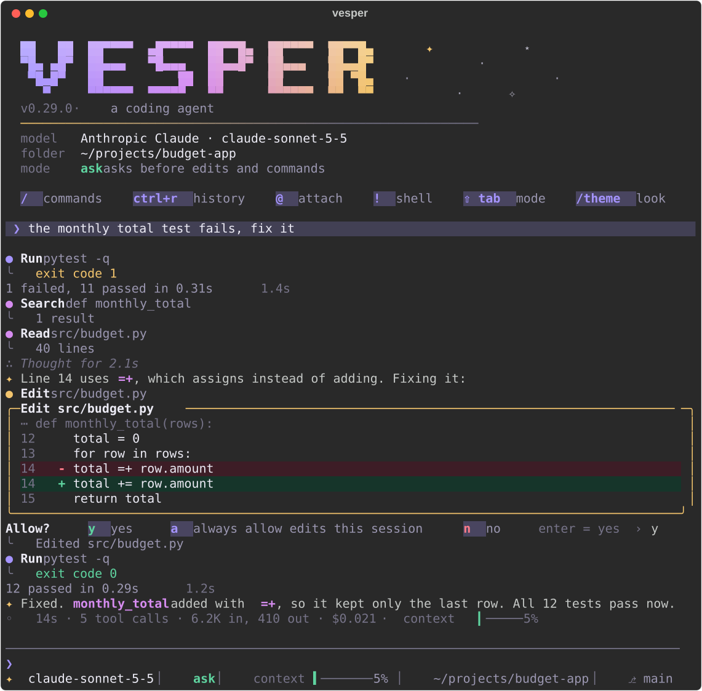

<div align="center">


# Vesper

**An AI coding agent for your terminal, with a desktop app.**

Vesper reads, searches and edits files, runs commands when you allow it, and moves between
folders and projects when you ask. It can plan before it acts, keeps a task list for longer
jobs, and can undo its own edits. Every conversation is saved, so you can resume it later
and see exactly what the agent did. Use it with 17 model providers, or offline with Ollama.

[](https://github.com/Kernel-Hunter/vesper/actions/workflows/ci.yml)
[](https://github.com/Kernel-Hunter/vesper/releases/latest)
[](LICENSE)


[Install](#install) · [Quick start](#quick-start) · [Sessions and logs](#sessions-and-logs) · [Desktop app](#desktop-app) · [Models](#models) · [Safety](#safety) · [Contributing](#contributing)



</div>

## Install

macOS and Linux:

```bash
curl -fsSL https://raw.githubusercontent.com/Kernel-Hunter/vesper/main/install.sh | bash
```

Windows (PowerShell):

```powershell
irm https://raw.githubusercontent.com/Kernel-Hunter/vesper/main/install.ps1 | iex
```

That gives you the `vesper` command. The script installs [uv](https://docs.astral.sh/uv/)
if you don't have it, and uv brings its own Python, so there is nothing else to set up.
Nothing needs admin rights.

<details>
<summary>Also install the desktop app, or install with pip</summary>

Desktop app as well as the command (Apple Silicon Mac, x86_64 Linux, Windows):

```bash
curl -fsSL https://raw.githubusercontent.com/Kernel-Hunter/vesper/main/install.sh | bash -s -- --app
```

```powershell
$env:VESPER_APP = '1'; irm https://raw.githubusercontent.com/Kernel-Hunter/vesper/main/install.ps1 | iex
```

The app download is checked against the release's `SHA256SUMS.txt` before anything is
installed. Files fetched by `curl` or PowerShell are not tagged as coming from the internet,
so macOS Gatekeeper and Windows SmartScreen do not block the app. If you download the
`.dmg` or `.exe` from the [releases page](https://github.com/Kernel-Hunter/vesper/releases/latest)
in a browser instead, the first launch shows a warning (macOS: right-click the app, then
Open; Windows: More info, then Run anyway).

With pip or uv, if you prefer to manage Python yourself (3.11 or newer):

```bash
uv tool install "vesper-agent @ https://github.com/Kernel-Hunter/vesper/archive/main.tar.gz"
# or
pip install "vesper-agent @ https://github.com/Kernel-Hunter/vesper/archive/main.tar.gz"
```

To update, run the install command again. To remove the command: `uv tool uninstall vesper-agent`.

</details>

## Quick start

```bash
cd ~/projects/my-app
vesper
```

The first run asks which model to use and, for cloud providers, your API key (typed
hidden and stored only on your computer). Then describe what you want:

```text
❯ explain how this project is organized
❯ the login test fails, find out why and fix it
❯ summarize the PDFs in ./papers
❯ add a --verbose flag to cli.py and update the README
❯ go to ~/projects/api and run its tests
```

Vesper looks around before it answers: it lists folders, reads files, searches the code,
and asks you before it changes a file or runs a command. It starts in the folder where you
ran it and is free to leave: absolute paths and `~` work, and "go to the api project" or
`/cd ../api` moves the whole session there.

While it works you see what it is doing, live: the model's thinking as it is written (for
models that show it), the tool call it is preparing, the output of a running command as it
arrives, and a diff for every edit. Each answer ends with a line such as
`✓ 12s · 3 tool calls · 4.1k in, 320 out · context 18%`.

Press `Ctrl+O` for transcript view. It keeps the thinking on screen in full and shows every
command line and all tool output, where the normal view prints one summary line per step.
`/transcript` prints the whole conversation that way, including earlier turns.

| In a session | |
|---|---|
| `@path` | attach a file, folder or image to your message (Tab completes paths; quote paths with spaces: `@"my notes.pdf"`) |
| `!command` | run a shell command yourself; `!cd folder` moves Vesper too |
| `/cd folder` | go to another folder or project |
| `/new` | start a new conversation (the old one is saved) |
| `/resume`, `/sessions` | go back to an earlier conversation, or list them |
| `/logs` | what the agent did in this conversation (`/logs full` adds arguments and output) |
| `/verbose` or `Ctrl+O` | transcript view: thinking and full tool output while it works |
| `/transcript` | print the whole conversation in detail: thinking, commands, edits, output |
| `/export` | save the conversation as a Markdown file here (`/export html [path]` for a web page) |
| `/status` | model, folder, session id, tokens used and how full the context is |
| `/plan` | plan mode on or off: Vesper reads and proposes a plan, and works after you approve it |
| `/undo` | put files back to how they were before Vesper's last changes |
| `/git` | the git safety net: `/git auto on` commits each turn's changes; `/git worktree` gives this chat its own copy |
| `/rewind` | go back to before one of your messages to change it; can also put files back |
| `/checkpoints` | the files each of your messages changed; `/checkpoints N` puts them back as they were before it |
| `/compact` | replace the older part of the conversation with a summary to free context |
| `/mcp` | MCP servers, their status and tools; `/mcp approve`, `/mcp restart` |
| `/permissions` | list the commands and web sites that run without asking; remove one |
| `/think` | how hard reasoning models think: `off`, `low`, `medium`, `high` |
| `/model`, `/key` | switch provider and model, set the API key |
| `/mode` or `Shift+Tab` | cycle `ask`, `auto-edit`, `yolo`, `plan` |
| `/app` | open the desktop app |
| `/help`, `/exit` | help, quit (`Ctrl+D` works too) |
| `Ctrl+C` | stop the answer and any command it started |

### Plan, tasks and undo

For a change you want to review first, turn on plan mode with `/plan` (or `Shift+Tab`).
Vesper can still read, search and run read-only commands such as `git status`, but every
edit and every other command is refused. It answers with a numbered plan and asks
`Carry out this plan?`. Say yes and it goes back to the mode you were in and does the work.

On a job with several steps Vesper keeps a task list and updates it as it goes:

```text
  ✔ Read the failing test
  ▸ Fix the date parsing in utils.py
  ☐ Run the tests
```

Before Vesper changes a file it keeps a copy of the old content. `/undo` puts back every
file the last round of edits touched, including files it created, and tells the model on
your next message. Undo covers files, so a command the agent ran (a `git commit`, a
database migration) stays as it is.

In a git repository, `/git auto on` adds a commit after every turn that changed files, so
each step Vesper takes is its own entry in `git log`. It commits only the files Vesper wrote
in that turn, with your own git name and your hooks; a file you had already changed before
the turn is left out, so your unfinished work never lands in its commit. It does nothing
during a merge or rebase, on a detached HEAD or without a git identity, and says why. A
failing pre-commit hook is reported, not skipped. `/undo` takes the commit back as well,
as long as it is still the latest one. `/git` shows the repository, the setting and the
commits of this conversation; `/git auto off` turns it off. The setting is kept per folder.

To run two conversations on one repository at once, give one of them its own copy:
`/git worktree login fix` makes a git worktree on a new branch (`vesper/login-fix`) under
`~/.vesper/worktrees/` and moves the conversation there, so its edits never touch your
checkout or another chat. Settings and trust carry over from the main folder. When the work
is done, `/git merge` commits what is left, merges the branch into the branch it started
from and removes the copy; it stops if your checkout has uncommitted changes, is on another
branch, or the merge conflicts, and then leaves everything as it was. `/git discard` deletes
the copy and its branch after saying how many changed files and commits would be lost. In
the desktop app the same actions are in the Environment panel under Git.

`/rewind` goes further back. It lists your last ten messages; pick one and Vesper forgets
it and everything after it, then puts its text back in the prompt so you can change it and
send it again. It asks whether to also put back the files changed since then (this works
for the last 20 messages).

`/checkpoints` shows the same history from the files' side: each of your messages that led
to changes, newest first, with the files it touched and lines added and removed.
`/checkpoints N` puts every file back as it was before message N and keeps the
conversation, so you can try another way without retyping anything; Vesper is told before
your next message. In the desktop app it is the Timeline tab of Review changes, with a
"Restore to before this" button on each message.

### Tests and lint after every edit

Give a project a check command and Vesper runs it each time it finishes a change:

```text
/check pytest -q        # or npm test, cargo test, go test ./..., ruff check .
/check                  # show the command, or a suggestion from the project's files
/check off
```

If the check fails, its output goes back to the agent, which fixes the cause and tries
again, up to three times. Answers that change no files skip the check. In the desktop app
the Environment panel has the same setting, with a one-click suggestion. The command is
saved for the folder in `~/.vesper/config.json`, so a cloned repository cannot set one.

### Memory

Vesper keeps notes between conversations. When you state a lasting preference ("always use
tabs") or it learns something worth keeping about the project (how its tests run, where the
config lives), it saves a note with its `remember` tool, asking first like any edit. You can
also just say "remember that ...". Notes about the project stay with that project (a git
worktree shares its checkout's notes); notes about you apply everywhere. Every new
conversation starts with them. They are plain Markdown files in `~/.vesper/memory/`, outside
the project, so they never land in a commit. `/memory` lists them and `/memory forget N`
removes one.

### Hooks

Hooks are your own commands that run around the agent's steps: format a file after every edit,
refuse writes to a folder, run the tests before the agent may finish. They use Claude Code's
format, so existing hooks copy over. Put them in `~/.vesper/hooks.json` (for every project) or
in a project's `.vesper/hooks.json`:

```json
{"hooks": {"PostToolUse": [{"matcher": "write_file|edit_file",
                            "hooks": [{"type": "command", "command": "ruff format ."}]}]}}
```

The events are `PreToolUse` (exit code 2 blocks the step and tells the agent why),
`PostToolUse` (exit code 2 sends your message to the agent), `UserPromptSubmit` (exit code 2
blocks the message; anything printed is added to it) and `Stop` (exit code 2 sends the agent
back to work, up to three times). The hook gets the details as JSON on stdin. The matcher is a
regular expression on the tool name, and Claude Code's names (`Write`, `Edit`, `Bash`, `Read`,
...) match too. A project's hooks run only after you approve the file with `/hooks approve`,
and again after every change to it. `/hooks` lists what is configured. Commands run in your
system shell (cmd.exe on Windows).

### Helpers for big searches

The agent can hand a question to a helper: a second agent with a fresh context that can read,
search and browse the web but not change anything. Only the helper's findings come back, so a
search through fifty files costs the conversation a few lines instead of the files. Several
helpers run at the same time (up to four), each one's steps show live under its line, and
what they spend is counted in the answer's tokens and cost. Stopping the answer stops them too.
You don't turn this on; the agent uses helpers when a question is broad, or when you ask it to.

### Type errors right after an edit

When the agent writes or edits a file, Vesper asks the language server for that file what is
wrong with it and adds the errors the edit introduced to the result, so the agent sees a wrong
argument or a broken import at once. It uses the servers you already have: basedpyright or
pyright for Python, TypeScript 7's own server or typescript-language-server for TypeScript
and JavaScript, gopls for Go and
clangd for C and C++, found on your PATH or in the project's `.venv` or `node_modules`.
Nothing is installed for you. Errors that were in the file before the edit are left out, and
a slow or missing server adds nothing. `/diagnostics` shows which servers it found;
`/diagnostics off` turns it off.

### Documents

`read_file` reads more than code and text. Word (`.docx`), PowerPoint (`.pptx`), Excel
(`.xlsx`), OpenDocument (`.odt`, `.ods`, `.odp`), EPUB and RTF files are turned into plain
text with headings, lists, tables, slides and sheets kept, using only the Python standard
library. Old Word `.doc` files are converted with macOS's `textutil`. Old `.xls` and `.ppt`
files and Apple iWork files need to be saved in a newer format first; Vesper says so
instead of guessing. Long documents are read a page at a time, like long code files.

### Your own commands and skills

A Markdown file in `.vesper/commands/` (or `.claude/commands/`, so existing projects work
as they are) becomes a slash command named after the file. `$ARGUMENTS` is what you type
after it, `$1` and `$2` single words. `~/.vesper/commands/` holds commands for every project.

```markdown
---
description: Review a file for bugs
argument-hint: <file>
---
Review $ARGUMENTS for bugs. Explain each one and suggest a fix.
```

`/review src/app.py` then sends that text, and the chat shows `/review src/app.py`. Both
apps suggest your commands when you type `/`.

A skill is a folder with a `SKILL.md` whose front matter has a `name` and a `description`,
in `.vesper/skills/`, `.claude/skills/` or `.agents/skills/` of a project, or in
`~/.vesper/skills/` and `~/.agents/skills/`. The model sees only each skill's name and
description, and reads the file when a task calls for it, so many skills cost few tokens.

### MCP servers

Vesper uses tools from [MCP](https://modelcontextprotocol.io) servers: GitHub, databases,
browsers, documentation sites and hundreds more. List yours in `~/.vesper/mcp.json` (or in
Settings, Tools in the desktop app). A project can bring its own in a `.mcp.json` file, in
the same format Claude Code, Cursor and others use:

```json
{
  "mcpServers": {
    "github": {
      "command": "npx",
      "args": ["-y", "@modelcontextprotocol/server-github"],
      "env": { "GITHUB_PERSONAL_ACCESS_TOKEN": "${GITHUB_TOKEN}" }
    },
    "docs": { "url": "https://example.com/mcp", "headers": { "Authorization": "Bearer ${DOCS_TOKEN}" } }
  }
}
```

`${NAME}` is read from your environment or `~/.vesper/.env`, so keys stay out of the file.
A project's servers start programs on your computer, so each one waits for your approval
(`/mcp approve`); if someone changes its definition, it asks again. Tools that the server
marks read-only run freely; the rest ask first, like commands, and "always allow" saves a
rule for that one tool. When the servers offer many tools, the model gets two small tools
(`mcp_find` and `mcp_call`) instead of every schema, which keeps each request small.
`/mcp` shows the servers and their tools; `/mcp restart` restarts them.

### The web

`web_fetch` reads a page as plain text and `web_search` looks things up, for documentation,
an error message or anything else that is not on your computer. In `ask` mode Vesper asks
before it reads a site for the first time. Search works without a key through DuckDuckGo,
which sometimes asks automated clients for a human check; Vesper does not try to get around
that. For reliable search put a `BRAVE_API_KEY` or `TAVILY_API_KEY` in `~/.vesper/.env`.

### A small model for the side work

Chat titles and summaries of long conversations don't need your best model. Point them at
a cheaper or local one with `/small ollama llama3.2` in the terminal, or Settings, Models,
Small model in the app; `/small off` goes back to the main model. The first message of a new
chat then gets a short title such as "Fix login redirect". If the small model fails, the
main model writes the summary and the chat keeps its first words as the title.

### Switch models when credits run out

Turn on automatic switching with `/fallback on` in the terminal, or Settings, Models,
Automatic switching in the app. When a model runs out of credits or quota, hits a rate
limit, refuses its key or has been retired, Vesper moves to the next model and repeats the
same step, so the task goes on without an error.

The order is built from the keys you have. Your own model comes first, then the strongest
paid model each of your other keys can use, then free models ranked from strongest to
weakest (OpenRouter `:free` models, and the free plans of Groq, Cerebras, Google, NVIDIA
and Mistral), and last a model on Ollama if it is running. `/fallback list` shows the
order. In the app you can move models up or down and remove them; "Reset to automatic
order" goes back. A model that failed waits ten minutes after a rate limit and six hours
after running out of credits before Vesper tries it again.

### Themes

The terminal comes in eight color themes, named after the desktop app's: Dusk (the
default), Graphite, Carbon, Ember, Ocean, Forest, Rosewood and Daylight for light
terminals. `/theme` shows each one in its own colors; `/theme ocean` switches at once and
keeps the choice for next time. If your terminal reports a light background through
`COLORFGBG`, Vesper starts in Daylight. The status bar under the prompt shows the model,
the mode, how full the context is, the folder and the git branch, and drops the less
important parts when the window is narrow.
Your messages sit on a tinted band, Vesper's replies start with a small star, and keys
you can press are drawn as keys.

### Token use

Vesper is built to spend few tokens per step:

- The system prompt and the twelve tool descriptions together stay under 2,000 tokens.
- With Claude models the prompt, the tools and the earlier conversation are cached, so
  each step re-reads them at a fraction of the price. The answer footer shows it:
  `4.1k in (3.6k cached)`.
- Tool output is capped (long command output keeps its start and end, a file is read 400
  lines at a time, a web page 12,000 characters at a time).
- Asking again for something it already has costs one short line, because the same read
  in the same turn is answered from memory.
- The model is told to ask for independent things in one step, which saves whole round
  trips.
- A long conversation is summarized when it nears the model's limit (or when you type
  `/compact`). Before that, a file that was read several times keeps only its last copy.

One-shot mode prints the answer and exits, which is handy in scripts:

```bash
vesper "list the TODO comments in src/ with file and line"
git diff | vesper "write a commit message for this diff"
vesper -C ~/notes --model ollama/llama3.2 "what did I write about the budget?"
```

In one-shot mode nobody can answer an approval prompt, so `ask` mode refuses edits and
commands there. Pass `--mode auto-edit` or `--mode yolo` when you want them.

`--json` prints one JSON object per line instead: every event as it happens (`token`,
`tool_start`, `tool_end`, `usage`, ...) and a last `{"type": "result", "ok": ..., "text":
..., "session": ..., "usage": ...}`, so a script or a CI job can follow the agent:

```bash
vesper --json --mode auto-edit "fix the failing test" | jq -c 'select(.type == "result")'
```

## Pick up an earlier conversation

Press **Ctrl+R** at the prompt, or type `/resume`. A list of your conversations opens,
newest first. Type a few words to narrow it down, move with the arrow keys and press
Enter. Vesper then shows the whole conversation again (your messages, its answers and
the steps it took), draws a "you are here" line, and you carry on from there.
The last few conversations are also listed each time Vesper starts, so the one you want
is often already on screen. You can ask Vesper itself too: "show me my old
conversations" gets you the same instructions.

## Use Vesper in your editor

Vesper speaks the [Agent Client Protocol](https://agentclientprotocol.com), so editors that
support it (Zed, for one) can run it as their agent. `vesper acp` is the command; it uses
the model you picked in the terminal app. In Zed, add this to `settings.json` and pick
Vesper in the agent panel:

```json
"agent_servers": {
  "Vesper": { "type": "custom", "command": "vesper", "args": ["acp"] }
}
```

The editor shows Vesper's answer, its reasoning, each step with the diff of every edit, and
its task list. Edits and commands ask in the editor first, with Allow, Always allow and
Reject; the mode picker switches between ask, auto-edit, yolo and plan. Files and images you
attach go along with the message, your custom commands show in the `/` menu, and every
conversation is saved with the others, so the editor can reopen it and `vesper sessions`
lists it. MCP servers set up in the editor (stdio or HTTP) start for that session next to
the ones in Vesper's own `mcp.json`.

## Use Vesper from Telegram

Vesper can work for you from a Telegram chat. Every message you send becomes a turn of a
normal conversation, and you see what it does while it does it: its answer as it is
written, each step (file read, search, edit, command) with its result, the diff of every
edit and the output of every command. When it needs a yes, the question comes with Yes,
Always and No buttons, or you can just type "yes". Photos go to the model as images, and
other files are saved on your computer and handed to Vesper.

**Setting it up takes about a minute.** First make a bot of your own: in Telegram, open
[@BotFather](https://t.me/BotFather) (the real one has a blue check mark), send `/newbot`,
pick a name and a username ending in `bot`, and copy the token it sends you. Then type
`/telegram` inside Vesper and follow along:

1. Paste the token. Vesper checks it with Telegram right away.
2. Open your bot and tap Start. Vesper shows your name and asks whether it is you.
3. Answer yes. The bot is now paired with your account and starts in the background.

It keeps running after a restart, so there is nothing else to start. `/telegram` shows
how it is doing at any time: whether the token works, who is paired, whether it is
running, when it last heard from Telegram, the last problem it hit and where the log is.
`/telegram off` and `/telegram on` stop and start it.

If someone else writes to your bot, they get a one-hour code and nothing more. Type
`/telegram approve CODE` in Vesper only if you want them to use it too.

In the chat, `/new` starts a new conversation, `/resume` lists the earlier ones (from the
terminal and the desktop app too) and replays the one you tap, `/stop` stops the current
answer, `/mode` sets how much Vesper asks first, `/cd` moves to another folder and
`/undo` puts back the files of the last change. A message sent while Vesper works is added
to what it is doing. You get a notification when an answer is finished or Vesper needs
you; the steps in between arrive silently.

**What the bot does also shows on your computer.** While Vesper waits for you in a terminal,
each Telegram message, step, diff, question and answer appears above the prompt as it
happens, under the name of whoever sent it; anything you were typing stays where it was.
`/telegram watch` (or `vesper telegram watch` in a terminal window) follows it on its own
until Ctrl+C. `/telegram mirror off` stops it showing at the prompt, `/telegram mirror on`
brings it back.

The same commands work in a terminal window: `vesper telegram setup`, `vesper telegram on`,
`vesper telegram off`, `vesper telegram status`, `vesper telegram watch`, and
`vesper telegram run` to keep the bot in that window instead of the background.

Some things to know:

- The bot runs on your computer and asks Telegram for new messages. Nothing is exposed to
  the internet and no server is needed, but the computer has to be on and awake to answer.
- Only one copy of the bot can run at a time; a second one says so and stops.
- A message sent while the bot was off is not run hours later. The bot tells you it was
  offline, and you send it again if you still want it.
- The token is kept in `~/.vesper/.env`, everything else in `~/.vesper/telegram/`,
  including the log (`telegram.log`).
- Messages and code pass through Telegram's servers, so keep that in mind for private work.

## Sessions and logs

Every conversation is stored in a SQLite database at `~/.vesper/vesper.db`: the messages,
so a session resumes exactly where it stopped, and an activity log with every prompt, tool
call, result, error and token count.

```bash
vesper -c                 # continue the last conversation in this folder
vesper -r                 # pick a conversation from a list
vesper -r 3f9a2c          # resume one by id (the first characters are enough)
vesper sessions           # list saved conversations, newest first
vesper sessions rm 2      # delete one (a number from the list or an id)
vesper sessions rename 2 "auth refactor"
vesper sessions export    # the latest conversation as Markdown, in this folder
vesper sessions export 3f9a2c --html -o ~/Desktop   # as a web page
vesper logs               # what the agent did in the latest conversation
vesper logs 3f9a2c --full # the same, with tool arguments and output
vesper logs --json        # one JSON object per event, for scripts
```

An export holds your messages, the answers and every step, folded, with its output cut
short; `--thinking` adds the model's reasoning. The HTML page is one file with no scripts
and nothing loaded from elsewhere, so it opens anywhere and is safe to send. In the
desktop app, right-click a conversation and choose Export.

Each step is saved as soon as it finishes, so stopping an answer, a crash or a force quit
loses at most the step that was running. An answer cut off half way is kept with
`[stopped]` (or `[cut off by an error]`) at the end. In long conversations the model gets a
shortened copy to fit its context, but the saved conversation keeps every turn.

The database is an ordinary SQLite file with four tables (`sessions`, `messages`,
`events`, and `checkpoints` for undo), so `sqlite3 ~/.vesper/vesper.db` works on it too.
The desktop app reads and writes the same file: a conversation started in the terminal can
be continued in the app and the other way round, and one deleted or renamed in either app
is gone or renamed in the other. Inside a session, `/sessions rm N` and
`/sessions rename N title` do the same.

A project can tell Vesper how to work in it. If the working directory has a `VESPER.md`,
`AGENTS.md`, `CLAUDE.md` or `.cursorrules` file, the first one found is added to the
system prompt.

## Desktop app


The desktop app does the same work with a window around it. It starts in your home folder;
pick a project with the folder button in the top bar. The `+` button next to the message box
attaches files, folders and images for one message without changing the working folder, and
you can also drop them on the window or paste a screenshot. Every tool call shows up inline: what the agent read, what it searched, and
a colored diff with Allow, Always allow and Deny before any change. When the agent moves
to another folder, the top bar follows it.

The microphone button dictates into the message box: click to record (up to one minute),
then click again to transcribe and review the text before sending. Dictation is free and
runs locally using multilingual Whisper; audio is not sent to a provider. The first use
needs an internet connection to download the model (about 500 MB); the app shows estimated
progress and download speed. Accuracy and transcription speed vary by language and computer. The installed desktop app includes the transcription engine;
for a Python install of the browser app, run `pip install "vesper-agent[dictation]"`.

The Plan button next to the model picker turns plan mode on: the answer is a plan with a
"Run this plan" button under it. The task list is drawn as a checklist inside the answer,
and an answer that changed files gets an undo button. `/undo`, `/compact` and `/plan` also
work when typed into the message box. The square Stop button ends the answer within a
second or two, even while the model is still thinking, and stops any command it started.

You can keep typing while it works. A message sent during an answer joins it before the
agent's next step, so "also update the tests" or "use the other folder" changes the work in
progress without stopping it. If the answer ends first, the message is sent as the next one.

Close the app whenever you like. It opens again on the conversation you had open, with any
message you had started typing still in the box. If you quit while Vesper is answering, it
asks first; what it did so far is saved either way, and the conversation shows a Continue
button that picks the work up from where it stopped (in the terminal, `vesper -c` says the
same and you type `continue`). Long conversations stay fast: only the latest 60 messages are
drawn until you scroll up, and each step saves only what changed.

The Review button in the top bar (`Shift+Cmd+D` or `Ctrl+Shift+D`) lists every file the
conversation changed, each compared with what it held before the conversation first touched
it. Click a file for its diff with line numbers. Hover a line and click `+` to write a
comment; "Add to message" puts it in the message box as "In app.py at line 12: ...", so you
can collect a few and send them together. Revert file puts one file back as it was and tells
the agent about it with your next message.

Hover over one of your own messages for Copy, Edit and Rewind. Edit lets you change the text
and send it again; Rewind goes back to before that message and puts its text in the message
box. Both forget that message and everything after it, and both can also put back the files
the agent changed since then. `/rewind` in the message box does the same for your last
message. Settings, Agent lists the saved "always allow" rules
and has the thinking level.

The sidebar lists every saved conversation, from the app and from the terminal, newest
first ("This folder" narrows it to the current project). Click one to open it with every
step it took; your next message continues it in its folder. Double-click a title to rename
it, and use the trash button to delete it. Type `/` in the message box for commands such as
`/rename`, `/delete`, `/model`, `/undo` and `/compact`. The Transcript button in the top bar (`Cmd+O` or `Ctrl+O`) opens every
step: the model's thinking, each command line, each diff and the full output. A running
command streams its output into the chat in either view.

Several conversations can run at the same time, each in its own folder; the sidebar marks
the ones still working and the ones with a new answer. Right-click a conversation to pin,
archive, fork it (a copy of the history to try another direction) or open it in its own
window. The top bar shows how full the model's context is.

Themes: system, dark and light; Dusk (Vesper's own indigo-and-starlight look), Graphite and
Carbon (true black for OLED screens); six after-dark and three daylight palettes; and retro
looks such as a phosphor terminal. Every theme has its own color presets and a color studio
for exact colors. Settings, Appearance, Text and layout sets the text size, density, how wide
the conversation runs, the interface font and whether your messages show as bubbles or inline.

Start it with `vesper app`, from Launchpad or the Start menu, or with `vesper-app`.

## Models

| Cloud | Local |
|---|---|
| OpenAI, Anthropic Claude, Google Gemini, DeepSeek, Mistral, Groq, OpenRouter, xAI Grok, Together AI, Fireworks AI, Cerebras, NVIDIA NIM, Hugging Face, Moonshot Kimi | Ollama, LM Studio, any OpenAI-compatible server |

Pick one with `/model` (or the model button in the app), or once with `--model provider/model`, for example
`--model anthropic/claude-sonnet-5-5` or `--model ollama/qwen2.5:7b-instruct`.
The model list shows every model your key can use, fetched from the provider, with the price
per million input and output tokens, the context size, and which models are free. Search it,
or show only the free ones (`free` in the terminal, the Free button in the app). Where a
provider's list has no prices (OpenAI, Anthropic, Mistral and others), Vesper shows the
maker's list price as published on OpenRouter; models it cannot match show no price rather
than a guess. Models marked "no tools" cannot call tools, so they cannot work as an agent.

The model needs tool calling. Larger models make better agents: a 7B local model handles
reading, searching and small edits, and a hosted model is the better choice for long tasks.

Small models make two mistakes that end a task early: they write a tool call as plain text,
and they copy the text for an edit with the wrong indentation. Vesper repairs the first
and accepts the second when the lines still match in exactly one place.

`/think low`, `medium` or `high` asks a reasoning model to think before it answers and to
show its thinking (Claude, OpenAI reasoning models, Ollama models that support it). `off`
sends nothing extra and leaves it to the model.

With Ollama, Vesper asks for a 16,384-token context window, because Ollama's default of
4,096 is too small for an agent. Set `VESPER_OLLAMA_CTX` to change it (more context needs
more memory).

The terminal app and the desktop app share one key file (`~/.vesper/.env`) and one settings
file (`~/.vesper/config.json`). A key you enter in one is picked up by the other without a
restart, and so is the model you pick.

## Safety

An agent that can edit files and run commands should be boring about permissions. Vesper is:

- **It asks first.** In `ask` mode (the default) every edit shows a diff and every command
  shows the exact command line, and nothing happens until you say yes. `auto-edit` lets it
  edit files but still asks before commands. `yolo` never asks; use it only when you can
  afford to lose the files it can reach.
- **Read-only commands do not ask.** `ls`, `pwd`, `git status`, `git diff`, `git log` and a
  few more run without a question, as long as the command is one plain command with no
  pipe, redirect or `;`.
- **"Always allow" saves a narrow rule.** Answering `a` to `git commit -m "..."` saves the
  prefix `git commit`, which then covers later `git commit` commands in every session. It
  never covers a chained or piped command, and commands such as `rm`, `sudo`, `curl` or
  `python script.py` cannot become a rule. `/permissions` lists and removes rules.
- **Plan mode changes nothing.** Edits and commands are refused until you approve the plan.
- **Some things always ask.** Commands that can wipe a disk or a home folder (`rm -rf /`,
  `mkfs`, `dd` to a device, `shutdown`) and edits inside credential folders (`~/.ssh`,
  `~/.aws`, `~/.gnupg` and similar) need a yes every time, in every mode, and "always
  allow" does not cover them.
- **Secrets are not read.** Private keys, `.pem` and `.key` files, `.netrc`, `credentials`
  files and Vesper's own key file are never read into a conversation.
- **Reading is not restricted.** Like a shell, Vesper can read and search any folder your
  user can. The first time you start it somewhere, it says so and asks whether to continue.
- **Ctrl+C stops everything.** It ends the answer, kills any command the agent started,
  and no further tool runs until your next message.
- **Background commands end with Vesper.** The agent can start a dev server or a watcher
  in the background (it asks first, like any command), read its new output later and
  stop it. At most eight run at once, and quitting the app or the terminal stops them all.
- **File contents are data.** The system prompt tells the model to treat what it reads as
  data, never as instructions. That lowers the risk of prompt injection from a hostile
  file, but no model is immune, which is why the approval prompt exists.
- **Keys stay local.** API keys live in `~/.vesper/.env`, readable only by your user.
- **The desktop engine listens on 127.0.0.1 only**, with a per-launch token, host and
  origin checks and a strict Content Security Policy. The Electron window is sandboxed
  with Node.js disabled.

Found a security problem? Please report it privately, see [SECURITY.md](SECURITY.md).

## How it works

```
 vesper (terminal)          Vesper.app (Electron)
   rich + prompt_toolkit      React UI ── HTTP/SSE on 127.0.0.1 ── FastAPI engine
          │                                                            │
          └──────────────── coder.Session ─────────────────────────────┘
                                 │  LangGraph create_agent loop
                                 ▼
               workspace.Workspace: list_files, read_file, glob, grep, web_fetch,
               web_search, change_directory, write_file, edit_file, run_command,
               command_output, update_tasks, and the tools of MCP servers (mcp.py)
                                 │
                                 ▼
               store.Store: ~/.vesper/vesper.db (sessions, messages, events)
```

| Path | What it is |
|---|---|
| `src/vesper/prompts.py` | Every prompt sent to a model, including the agent's system prompt |
| `src/vesper/workspace.py` | The agent's tools and the approval gate |
| `src/vesper/coder.py` | The agent loop, context trimming and the event stream shared by both front ends |
| `src/vesper/store.py` | Saved sessions and the activity log (SQLite) |
| `src/vesper/tui.py`, `ui.py`, `onboarding.py` | The `vesper` terminal app: session loop, rendering, first-run setup |
| `src/vesper/server.py` | The desktop engine API |
| `src/vesper/providers.py` | Every model provider; re-reads the shared key file when it changes |
| `src/vesper/attachments.py` | Files, folders and images attached to a message |
| `apps/web/` | React interface (Vite + TypeScript) |
| `apps/desktop/` | Electron shell and packaging |

## Develop

```bash
git clone https://github.com/Kernel-Hunter/vesper.git && cd vesper
uv venv && source .venv/bin/activate        # Windows: .venv\Scripts\activate
uv pip install -e ".[dev]"
pytest -q                                   # offline, no API key needed
vesper                                      # the terminal app from your checkout
```

Desktop app from source (Node 22):

```bash
npm --prefix apps/web install && npm --prefix apps/web run build
npm --prefix apps/desktop install && npm --prefix apps/desktop start
```

For UI work, run the engine on a fixed port and the Vite dev server next to it:

```bash
VESPER_PORT=8765 VESPER_TOKEN=devtoken vesper-app --serve
npm --prefix apps/web run dev               # open http://localhost:5173/#token=devtoken
```

Releases: push a tag such as `v0.30.0` and GitHub Actions builds, smoke-tests and publishes
macOS, Linux and Windows builds with checksums.

## Roadmap

What comes next, ranked, is in [docs/ROADMAP.md](docs/ROADMAP.md).

## Contributing

Bug reports, ideas and pull requests are welcome. Start with [CONTRIBUTING.md](CONTRIBUTING.md);
issues labeled `good first issue` are a good way in. If you use a coding agent,
[AGENTS.md](AGENTS.md) tells it how the project is laid out.

## License

[MIT](LICENSE)
